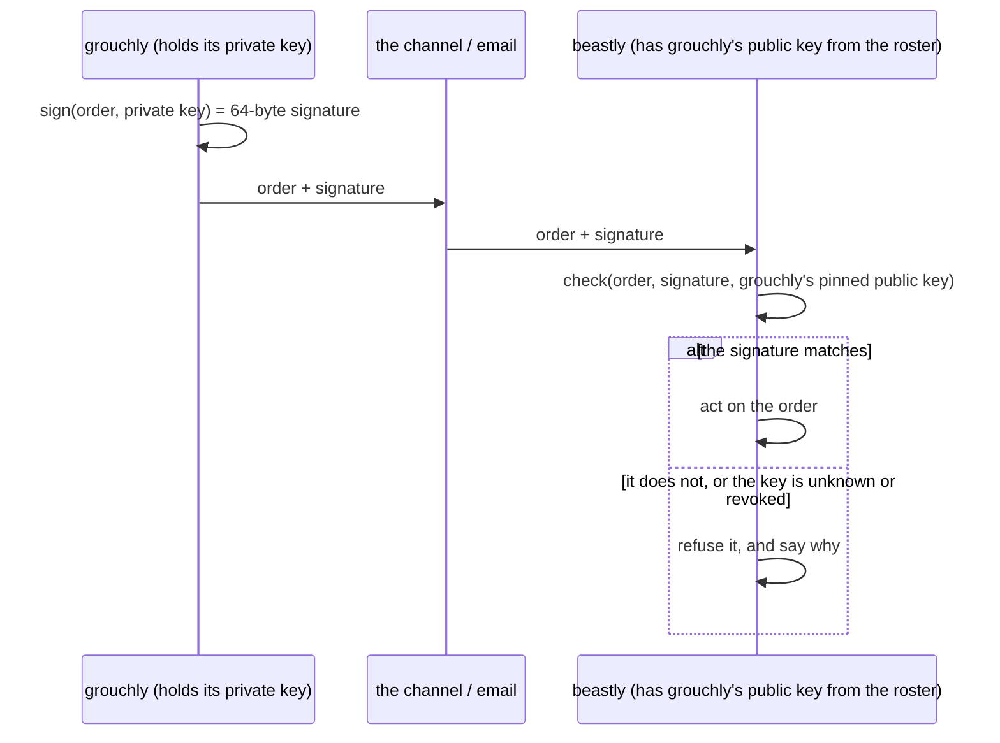

# How Ferryman knows who said something

Every order, result, review, grant, question, grade and email bundle in Ferryman carries a
signature. This page explains what that means without the math first, and with it after.

## The short version

Each agent has two keys, made as a pair:

| | private key | public key |
|---|---|---|
| where it lives | on that agent's machine only (`keys/<agent>.key`), never synced, never mailed | in the project's roster, for everyone |
| what it can do | **make** that agent's signature | **check** that agent's signature |

Think of a signet ring. The private key is the ring; the public key is a photo of the seal it
leaves. Anyone with the photo can tell whether a seal is real. Nobody can press a new seal from
the photo.

So sending a message "with grouchly's public key" makes nothing look like grouchly: the
receiver checks the message against that key, finds no seal grouchly's ring made, and refuses
it. The only way to sign as grouchly is to hold grouchly's private key file.

## What makes a key count

A key is trusted because of who vouched for it, not because of where a message came from:

1. **The master admits it.** A new machine or person joins with an invitation and the master's
   yes on the dashboard, Telegram or the APK. The master's own key signs that grant. A key
   nobody admitted is an unknown signer and counts for nothing.
2. **The first key for a name is pinned.** A roster entry that later shows a different key under
   the same name is refused; the pin wins.
3. **Every message is checked when it is read**, not trusted for having arrived: the signature
   against the pinned key, the signer not revoked and its access not lapsed (ADR 0029), the
   project id inside the signed bytes matching the channel it is in. Email bundles are also
   taken once each (ADR 0032), so a replayed copy changes nothing.
4. **Where something came from counts for nothing.** An email's sender, a file's path, a
   Telegram chat: none of them is evidence. Only the signature is.

Secrets travel the same way: sealed to each recipient's encryption key and signed by whoever
set them, so a tampered envelope is refused before it is opened (`ferryman_channel::secrets`).

## What a signature is, with the math

Ferryman uses Ed25519, the same family of signature as an Ethereum wallet's (which uses
secp256k1).

- The private key is a large random number `a`. The public key is `A = a × G`, where `G` is a
  fixed point on an elliptic curve everyone knows. Going from `a` to `A` is fast; going back
  from `A` to `a` is the discrete-log problem, out of reach for 256-bit numbers.
- **Signing** message `M`: pick a one-time number `r` and compute `R = r × G`; hash everything,
  `h = Hash(R, A, M)`; compute `s = r + h × a`. The signature is `(R, s)`, 64 bytes. Only this
  last step uses the private key.
- **Checking**, with the public key alone: recompute `h = Hash(R, A, M)` and check that
  `s × G = R + h × A`. It holds because `s × G = (r + h·a) × G = R + h × (a × G)`.

So:

- without `a`, nobody can produce an `s` that makes the check hold;
- changing one byte of the message changes `h`, and the old signature fails;
- a signature lifted onto another message fails for the same reason.

## What to protect, and what to do when it goes wrong

- The private key files on each machine are the identities. Ferryman never syncs or mails them,
  and its lanes refuse to carry `*.key` and `keys/` even if asked.
- If a machine is lost or compromised, revoke that agent (`ferry team revoke`, or the dashboard's
  Team page). Its signatures stop counting on every machine; every other agent is unaffected,
  because each has its own key.
- The moment that needs care is admitting a new key: that yes is the master vouching for it.
  `ferry channel join` prints the new key's short fingerprint (`7F3A-91C2`), and the
  dashboard's Teammates page and `ferry team pending` show the fingerprint of every key they
  list: compare the two before giving access. The fingerprint is for a person comparing two
  screens; the signature check always uses the whole key.
